# Tfa Mistake Tracker

Tracks mistakes made by players throughout The Fractured Archives.

---
This plugin will track mistakes for you and your teammates in The Fractured Archives.

By default, when detecting a mistake, all players with this plugin will receive a public message of the mistake, a chat
overhead above the player who made the mistake, and the mistake will be added to the Tfa Mistake Tracker side-panel.

Current mistakes being tracked:

*  **Deaths** throughout the raid
    * 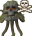 **Death in the Archive Guardian room**
    * 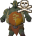 **Death in the Bork room**
    * 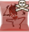 **Death in the Dreadnoth room**
    * 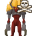 **Death in the Xarth room**
    * 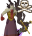 **Death at Ocellus**
    *  **Death in the Ezekiel, Moia or Dagon'hai rooms**
* 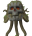 **Archive Guardian**
    * 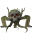 **Fall** damage
    * 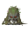 **Melee** damage while under him
    * 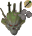 **Rock** prayer miss
    *  **Mushroom explosion** damage
    * 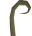 **Vine** damage
* 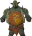 **Bork**
    * 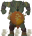 **Stomp wave** damage
    * 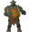 **Melee** prayer miss
    * 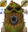 **The Smorks ranged and magic attacks** prayer miss
    * 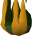 **The Smorks fireball** damage
    *  **Room fire** damage
* 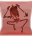 **Dreadnoth**
    * 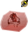 **Jump slam** prayer miss
    *  **Ranged attack** prayer miss
    *  **Blood pool** damage
    * 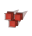 **Blood ball** damage
    * 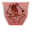 **Landing** on you
    * 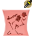 **Jelly** prayer miss
    * 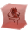 **Standing inside** Dreadnoth
* 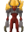 **Xarth**
    * 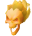 **Tether fireball** damage
    * 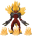 **Flame blast explosion** damage
    *  **Room fire** damage
    * 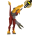 **Melee** prayer miss
    * 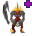 **Corpse heal** team mistake
* 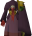 **Ocellus P1**
    * 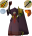 **Magic and ranged attacks** prayer miss
    * 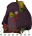 **Slam** damage
* 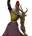 **Ocellus P2**
    * 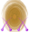 **Portal projectile** damage
    *  **Purple tile** damage
* 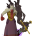 **Ocellus P3 / P4**
    *  **Void bomb and void floor** damage
    * 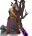 **Shadow slash** damage
    * 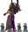 **Superior slash (Insolence)** damage
    * 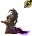 **Melee parry** prayer miss
    * 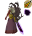 **Tank not in melee range**, causing his magic attack on everyone
    * 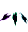 **Void rift, siphon or augmenter detonation** team mistake
    * 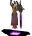 **Untether explosion** damage
    * 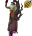 **Untether special** magic prayer miss
    * 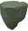 **Falling into the abyss**
    * 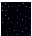 **Space tiles** damage
    * 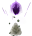 **Void explosion** damage
    * 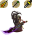 **Prayer attack** prayer miss

Coming soon, in a later release (only deaths are tracked in these rooms for now):

* **Ezekiel**
* **Moia**
* **Dagon'hai trio**

---

## Screenshots

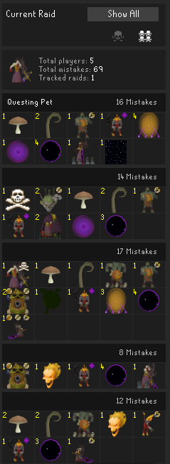

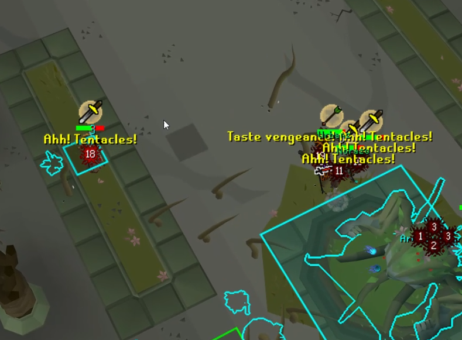

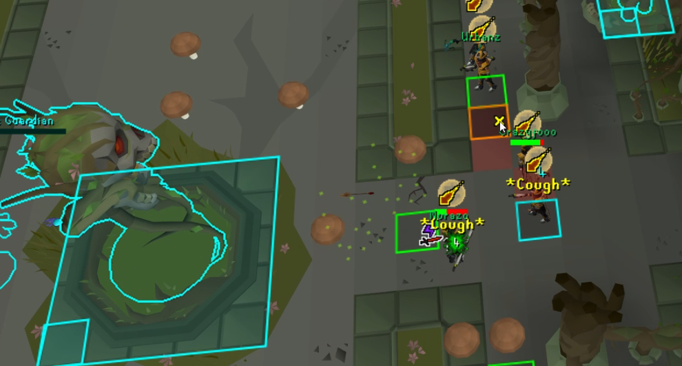

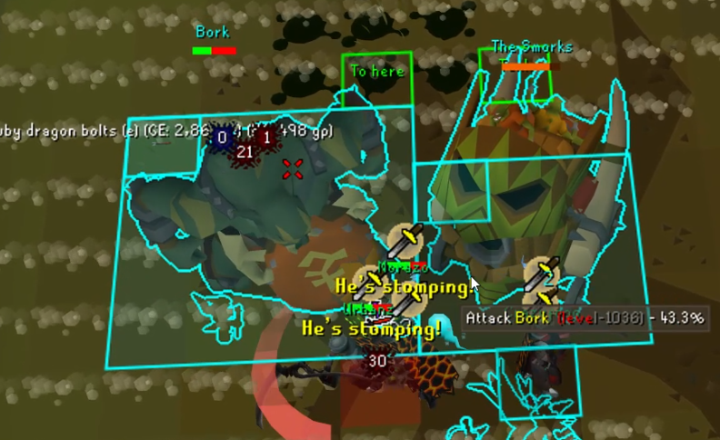

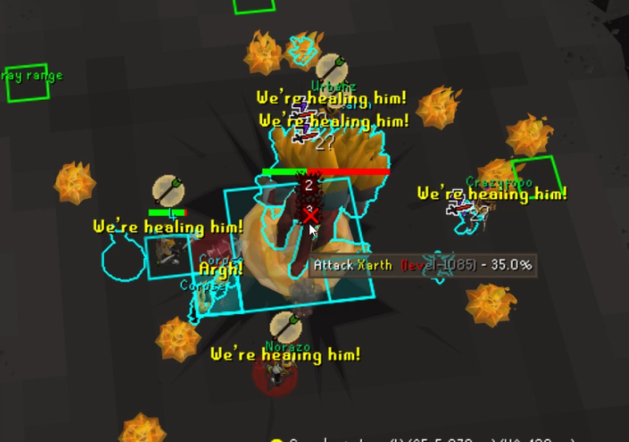

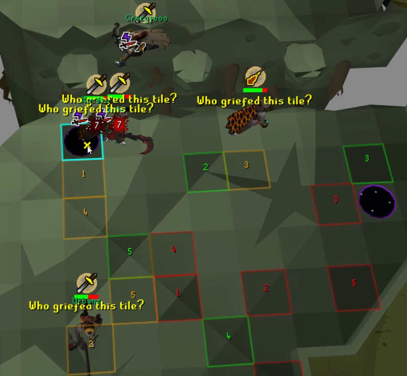

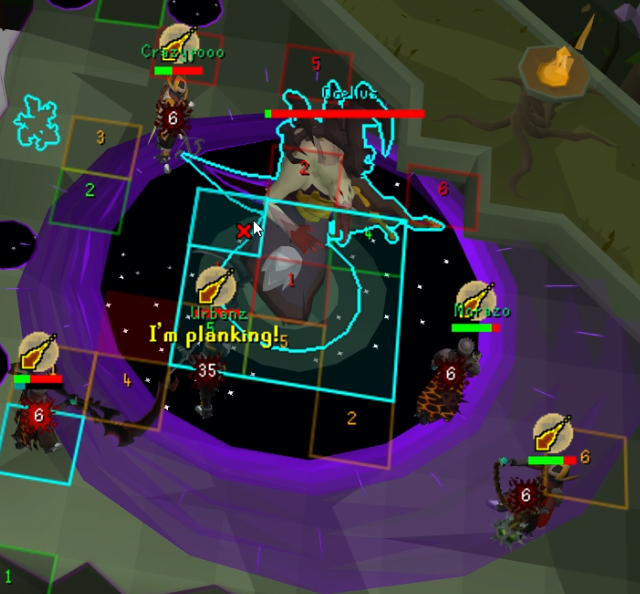

---

## Changes

#### 1.0

* Initial release
